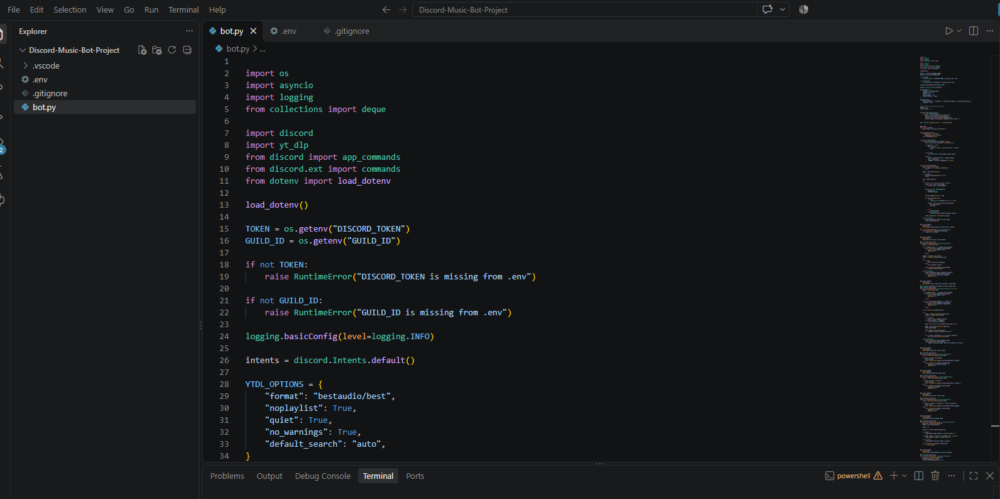
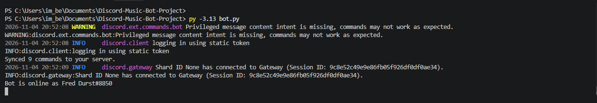

# Discord Music Bot

A Python-based Discord music bot that supports audio playback, voice channel connections, and music queue management using Discord slash commands.

## Project Overview

I developed this Discord music bot using Python 3.13, discord.py, FFmpeg, and yt-dlp.

The project involved configuring a Discord application, installing Python dependencies, integrating audio playback, and troubleshooting connection and compatibility issues.

## Technologies Used

- Python 3.13
- discord.py
- Discord API
- FFmpeg
- yt-dlp
- Visual Studio Code
- Windows 11

## Features

The bot supports nine Discord slash commands:

| Command | Description |
|---------|-------------|
| `/ping` | Check whether the bot is online |
| `/join` | Join a voice channel |
| `/play` | Play audio from a supported URL |
| `/pause` | Pause music playback |
| `/resume` | Resume paused music |
| `/skip` | Skip the current song |
| `/queue` | Display the current song and upcoming tracks |
| `/stop` | Stop playback and clear the queue |
| `/leave` | Disconnect from the voice channel |

## Project Setup and Configuration

### Step 1 — Install Python

Installed Python 3.13 and verified the installation:

```powershell
py -3.13 --version
```

### Step 2 — Install FFmpeg

Installed FFmpeg and configured the Windows PATH environment variable.

Verified FFmpeg using:

```powershell
ffmpeg -version
```

FFmpeg handles audio processing for Discord voice playback.

### Step 3 — Install Python Dependencies

Installed the required libraries:

```powershell
py -3.13 -m pip install -U "discord.py[voice]" python-dotenv yt-dlp
```

### Step 4 — Create the Discord Application

1. Opened the Discord Developer Portal.
2. Created a new application and bot.
3. Configured the required permissions.
4. Enabled the bot and application command installation scopes.
5. Invited the bot to my Discord server.

### Step 5 — Develop the Bot

Created `bot.py` in Visual Studio Code.

Implemented Discord slash commands, voice channel connectivity, music playback, and queue management.

Used yt-dlp to extract audio stream information and FFmpeg to process audio for playback.

### Step 6 — Configure Environment Variables

Created a `.env` file containing the bot token and Discord server ID.

```dotenv
DISCORD_TOKEN=YOUR_BOT_TOKEN
GUILD_ID=YOUR_SERVER_ID
```

Configured `.gitignore` to prevent private credentials from being committed to GitHub.

### Step 7 — Start the Bot

Started the application using:

```powershell
py -3.13 bot.py
```

Verified that the bot connected to Discord and synchronized all nine slash commands.

### Step 8 — Test the Bot

Tested the bot inside my Discord server.

- Confirmed the bot appeared online.
- Verified that slash commands were registered.
- Used `/play` to add a song.
- Used `/queue` to display the currently playing song.
- Confirmed successful voice channel connections.
- Verified FFmpeg process execution through terminal logs.

## Project Screenshots

### 1. Project Structure

Visual Studio Code showing the Python project files and source code.



### 2. Python Source Code

Implementation of the `/play` command, including voice channel and URL validation.


### 3. Bot Running Successfully

Terminal showing the bot connected to Discord and nine synchronized commands.



### 4. Discord Slash Commands

Discord displaying the music bot's available slash commands.


### 5. Music Playback Command

Discord showing a successful `/play` command response.


### 6. Music Queue

Discord showing the currently playing song using `/queue`.


## Troubleshooting

During development, I resolved several technical issues:

- Python version compatibility problems with Discord voice dependencies.
- Missing Python libraries and dependency installation errors.
- FFmpeg installation and Windows PATH configuration.
- Discord bot connection and authentication issues.
- Slash command synchronization problems.

## Skills Demonstrated

- Python programming
- Discord API integration
- Software installation and configuration
- Dependency management
- Audio processing with FFmpeg
- Troubleshooting and debugging
- Environment variable management
- Technical documentation

## Project Summary

Successfully developed and tested a Python Discord music bot with nine slash commands, audio playback functionality, voice channel integration, and music queue management.

This project demonstrates practical experience with Python development, API integration, application configuration, and technical troubleshooting.
  
