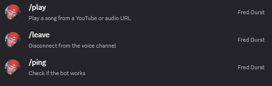

# Discord Music Bot — Python Project

## Project Overview

I developed a Discord music bot using Python, discord.py, FFmpeg, and yt-dlp. The bot connects to Discord voice channels, plays audio from supported URLs, and manages music queues using Discord slash commands.

This project demonstrates hands-on experience with Python programming, API integration, software configuration, audio processing, dependency management, and technical troubleshooting.

## Software Requirements and Downloads

The following software was used to develop and test this project on Windows 11.

| Software | Version Used | Download |
|---|---|---|
| Python | 3.13.12 | [Download Python](https://www.python.org/downloads/release/python-31312/) |
| FFmpeg | 9.0.2 | [Download FFmpeg](https://ffmpeg.org/download.html) |
| Visual Studio Code | Version not recorded | [Download VS Code](https://code.visualstudio.com/download) |
| discord.py | Version not recorded | [discord.py](https://pypi.org/project/discord.py/) |
| yt-dlp | Version not recorded | [yt-dlp](https://pypi.org/project/yt-dlp/) |
| python-dotenv | Version not recorded | [python-dotenv](https://pypi.org/project/python-dotenv/) |
| PyNaCl | Version not recorded | [PyNaCl](https://pypi.org/project/PyNaCl/) |

### Verify Software Versions

Check Python:

```powershell
py -3.13 --version
```

Check FFmpeg:

```powershell
ffmpeg -version
```

Check installed Python packages:

```powershell
py -3.13 -m pip show discord.py yt-dlp python-dotenv PyNaCl
```

## Features

The bot supports nine Discord slash commands.

| Command | Description |
|---|---|
| `/ping` | Check whether the bot is online |
| `/join` | Join a voice channel |
| `/play` | Play audio from a YouTube or supported audio URL |
| `/pause` | Pause the current song |
| `/resume` | Resume paused music |
| `/skip` | Skip the current song |
| `/queue` | Display the currently playing song and upcoming tracks |
| `/stop` | Stop playback and clear the music queue |
| `/leave` | Disconnect from the voice channel |

## Project Setup and Configuration

### Step 1 — Install Python

Downloaded and installed Python 3.13.12.

Initially encountered compatibility issues with Python 3.15 prerelease and Discord voice dependencies. Switched to Python 3.13 to resolve the installation problems.

Verified Python using:

```powershell
py -3.13 --version
```

### Step 2 — Install FFmpeg

Downloaded and installed FFmpeg 9.0.2.

Configured the Windows PATH environment variable so FFmpeg could be accessed through Command Prompt and PowerShell.

Verified the installation:

```powershell
ffmpeg -version
```

FFmpeg is responsible for processing audio streams used during Discord voice playback.

### Step 3 — Install Python Dependencies

Installed the required Python libraries using pip:

```powershell
py -3.13 -m pip install -U "discord.py[voice]" python-dotenv yt-dlp
```

The libraries serve different purposes:

- **discord.py:** Discord API integration, slash commands, and voice channel connectivity.
- **python-dotenv:** Loads environment variables from a `.env` file.
- **yt-dlp:** Extracts audio stream information from supported URLs.
- **PyNaCl:** Provides voice-related functionality required by discord.py.

### Step 4 — Create the Discord Application

1. Opened the [Discord Developer Portal](https://discord.com/developers/applications).
2. Created a new Discord application.
3. Created and configured the bot.
4. Configured permissions for sending messages and joining voice channels.
5. Enabled the `bot` and `applications.commands` installation scopes.
6. Invited the bot to my Discord server.

### Step 5 — Develop the Python Bot

Created `bot.py` using Visual Studio Code.

Implemented nine slash commands and the logic required for voice channel connections, audio playback, and music queue management.

Used yt-dlp to retrieve audio stream information and FFmpeg to process audio for playback.

The bot also includes input validation and error handling for voice channel connections and invalid URLs.

### Step 6 — Configure Environment Variables

Created a `.env` file to store the Discord bot token and server ID.

Example configuration:

```dotenv
DISCORD_TOKEN=YOUR_BOT_TOKEN_HERE
GUILD_ID=YOUR_SERVER_ID_HERE
```

Configured `.gitignore` to exclude the private `.env` file from version control.

The actual Discord bot token is not included in this repository.

### Step 7 — Run the Discord Bot

Opened the project folder in Visual Studio Code and started the bot using:

```powershell
py -3.13 bot.py
```

Verified that the application connected to the Discord Gateway and synchronized all nine slash commands.

### Step 8 — Test the Discord Bot

Tested the application inside my Discord server.

- Confirmed the bot appeared online.
- Verified that Discord slash commands were available.
- Used `/play` to add a song to the music queue.
- Used `/queue` to display the currently playing song.
- Confirmed successful voice channel connectivity.
- Verified FFmpeg execution through terminal logs.

## Project Screenshots

### 1. Project Structure

Visual Studio Code showing the Discord Music Bot project files and Python source code.


### 2. Python Source Code

Implementation of the `/play` command, including voice channel validation and URL checking.


### 3. Bot Running Successfully

Terminal showing the bot successfully connected to Discord and all nine slash commands synchronized.


### 4. Discord Slash Commands

Discord displaying the music bot's available slash commands.



### 5. Music Playback Command

Discord showing a successful `/play` command response and a song added to the queue.


### 6. Music Queue

Discord displaying the currently playing song using the `/queue` command.


## Troubleshooting

During development, I encountered and resolved several technical issues.

### Python Compatibility

Encountered dependency installation errors while using Python 3.15 prerelease.

Installed Python 3.13.12 and configured Visual Studio Code to use the compatible Python interpreter.

### Missing Dependencies

Resolved missing Python library errors by installing the required packages using pip.

### FFmpeg Configuration

Installed FFmpeg and updated the Windows PATH environment variable to make the executable accessible from the terminal.

### Discord Bot Connection

Configured the Discord application, bot token, permissions, and server installation settings.

### Slash Command Synchronization

Configured guild-specific slash command synchronization to make the bot commands available inside the Discord server.

## Skills Demonstrated

- Python programming
- Discord API integration
- Software installation and configuration
- Python dependency management
- FFmpeg audio processing
- Troubleshooting and debugging
- Environment variable management
- Application testing
- Technical documentation

## Project Summary

Successfully developed and tested a Python Discord music bot supporting nine slash commands, voice channel integration, audio playback, and music queue management.

This project provided practical experience with Python development, API integration, software configuration, and technical troubleshooting.
